<h1 align="center">NoxlyDev</h1>

  <b>Software Engineer · Systems &amp; Rust · Full-stack · Indie Game Dev</b>

  

  
  

 

## 🧑‍💻 About Me

Software engineer handling systems architecture, product development, and infrastructure end to end. Self-taught, with skills built through shipping real projects, writing thorough documentation, and deliberate practice.

- 🦀 **Systems & Security**: cryptographic license gateways, automated threat-defense tooling, and lightweight services in **Rust**
- 🚀 **Full-stack**: modern web applications with SvelteKit, Next.js, and React
- 🎮 **Game Development**: gameplay and systems in **Godot**
- 🔧 **Infrastructure**: self-hosting, Linux server orchestration, Pterodactyl, and CI/CD pipelines

 

🌐 **Portfolio:** [noxlydev.xyz](https://www.noxlydev.xyz) &nbsp;·&nbsp; 📫 **Contact:** [help@noxlydev.xyz](mailto:help@noxlydev.xyz)

 

## 🌐 Connect

  
  
  
  

 

## 💻 Tech Stack

**Languages** 

**Backend & Runtime** 
 
Rust services built with Axum on Tokio · Python APIs with FastAPI

**Frontend & Mobile** 

**Databases** 
&nbsp;&nbsp;

**Infrastructure & DevOps** 

**Build & Tools** 

**Game Development** 

 

## 📊 GitHub Stats

  

  

 

### 🧬 Languages

Counted by lines of code across all my repositories, public and private, and refreshed daily.

  

  

  Crafted with precision by <a href="https://www.noxlydev.xyz">NoxlyDev</a>

